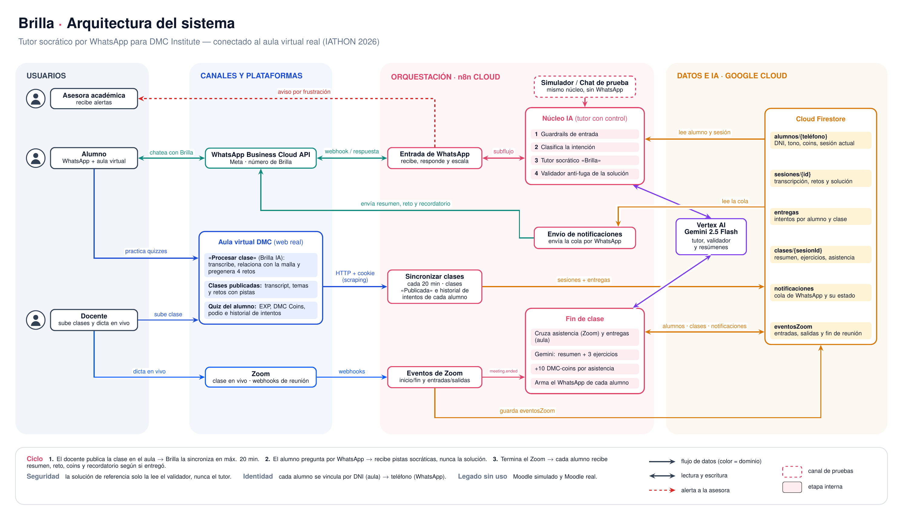

# Brilla — tutora WhatsApp de DMC Institute (IATHON)

Brilla es una tutora que acompaña por WhatsApp a los alumnos de DMC Institute: resume cada clase, les da ejercicios de práctica, les recuerda sus tareas y responde sus dudas con un tutor con guardrails (nunca les resuelve la tarea). Todo corre en **n8n** (orquestación), **Firestore** (datos), **Gemini en Vertex AI** (el modelo) y la **API de WhatsApp Business Cloud** (el canal).

Este repo es el código fuente del sistema: los workflows de n8n exportados como JSON, más la documentación de arquitectura y de costos que se usó para decidir y presentar la solución.

## Arquitectura

Fuente editable en [`docs/arquitectura/arquitectura_brilla.tex`](docs/arquitectura/arquitectura_brilla.tex) (TikZ/LaTeX) y PDF en [`docs/arquitectura/arquitectura_brilla.pdf`](docs/arquitectura/arquitectura_brilla.pdf).

## Workflows (`workflows/`)

Cada archivo es la exportación JSON de un workflow de n8n (Workflow → Download). Para usarlos: importarlos en una instancia de n8n y reconectar las credenciales (ver "Credenciales" abajo) — las credenciales de n8n **no viajan en el export**, solo quedan referenciadas por nombre.

### En producción

| Archivo | Workflow | Qué hace |
|---|---|---|
| `eventos-zoom.json` | DMC · Eventos de Zoom | Webhook que recibe los eventos de la app de Zoom (validación de URL + `meeting.ended`/`participant_joined`/`participant_left`), los guarda en Firestore `eventosZoom` y dispara "Fin de clase" cuando termina la reunión. |
| `sincronizar-clases-web-real.json` | DMC · Sincronizar clases desde aula virtual (web real) | Cada 20 minutos, entra como admin al aula virtual real de DMC, recorre los 6 cursos de la especialización y guarda cada clase publicada (transcripción, temas, retos y su solución de referencia) en Firestore `sesiones`. |
| `fin-de-clase.json` | DMC · Fin de clase | Cruza la asistencia de Zoom con los alumnos de Firestore, le pide a Gemini un resumen + 3 ejercicios de práctica a partir de la transcripción real, suma DMC-coins, empareja alumnos y deja el WhatsApp de cada uno listo en `notificaciones`. |
| `nucleo-ia-tutor.json` | DMC · Núcleo IA (tutor con control) | El cerebro del chatbot, como subworkflow: guardrails de entrada (jailbreak / suplantación de autoridad) → clasificador de intención → tutor socrático con Gemini (nunca ve la solución de referencia) → validador que compara la respuesta propuesta contra esa solución → respuesta segura si hay fuga. |
| `entrada-whatsapp.json` | DMC · Entrada de WhatsApp | Recibe los mensajes reales de WhatsApp, llama al Núcleo IA, responde al alumno y avisa a la asesora por WhatsApp cuando detecta frustración. |
| `simulador-api-chatbot.json` | DMC · Simulador / API del chatbot | Mismo Núcleo IA que WhatsApp, pero como endpoint `POST /webhook/simulador/mensaje` — lo usan el segundo alumno de la demo y cualquier frontend. |
| `chat-prueba-tutor.json` | DMC · Chat de prueba del tutor | Chat público de n8n para probar el Núcleo IA a mano, sin pasar por WhatsApp. |
| `seed-datos-demo-firestore.json` | DMC · Cargar datos de demo en Firestore | Workflow inactivo, de un solo uso: carga 6 alumnos y una sesión de ejemplo en Firestore para poder hacer una demo sin depender de datos reales. |

### Legacy (ya no los llama nada; se conservan como historial del build)

| Archivo | Por qué quedó obsoleto |
|---|---|
| `legacy-moodle-simulado.json` | Primera versión de la demo: imitaba la API REST de Moodle con datos ficticios, antes de que el equipo construyera la web real del aula virtual. |
| `legacy-moodle-real-lectura.json` | Leía un Moodle real de prueba. Quedó huérfano cuando "Fin de clase" pasó a leer la malla y la tarea desde `sesiones` (sincronizada por `sincronizar-clases-web-real.json`). |

> Pendiente conocido: la web real del aula virtual todavía no expone por API quién *entregó* cada tarea, así que el campo `entregoTarea` queda en falso para todos en "Fin de clase". No rompe nada (es solo un texto del mensaje), y está documentado en el sticky note del propio workflow.

## Datos (Firestore, proyecto `noted-bliss-511220-p7`)

- `alumnos/{telefono}` — nombre, apodo, tono elegido, curso, pareja de estudio, DMC-coins, racha de asistencias.
- `sesiones/{id}` — título, resumen, transcripción, tarea vigente (enunciado + solución de referencia, que solo lee el validador), próxima clase.
- `clases/{sesionId}` — resumen y asistencia ya generados de cada clase.
- `eventosZoom` — eventos crudos del webhook de Zoom.
- `notificaciones` — cola de WhatsApp pendientes de envío (`estado: pendiente_whatsapp`).

## Credenciales y secretos

**Nada de esto va en este repo.** Al exportar un workflow, n8n solo deja el *nombre* de la credencial usada (p. ej. "Google Cloud DMC (cuenta de servicio)", "WhatsApp Business DMC"); el secreto en sí vive en el almacén de credenciales de la instancia de n8n.

Dos nodos tenían un valor sensible escrito directo en sus parámetros (no en una credencial) y se reemplazaron por un placeholder antes de subir el export:

- `sincronizar-clases-web-real.json` → nodo **"POST login admin (aula real)"**: la contraseña del admin del aula virtual. Debe configurarse como credencial o variable de entorno de n8n, nunca como texto plano en el nodo.
- `eventos-zoom.json` → nodo **"Firmar plainToken"**: el Secret Token de la app de Zoom (se usa para la validación HMAC del webhook). Mismo tratamiento.

Si vas a re-exportar un workflow desde n8n para actualizar este repo, revisa primero que ningún nodo tenga un token/contraseña escrito directo en sus parámetros.

## Documentación de soporte (`docs/`)

- `docs/arquitectura/` — diagrama de arquitectura del sistema completo (fuente TikZ + PDF + PNG).
- `docs/costos-whatsapp/` — informe de 4 páginas con la predicción de costos de WhatsApp Business (tarifas de Meta para Perú vigentes desde oct-2026) para presentar al dueño de DMC Institute, más el modelo de costos en Python (`modelo.py`, `gen_cifras.py`) que generó las cifras del informe.

## Stack

n8n (sninaore.app.n8n.cloud) · Firestore · Gemini 2.5 Flash en Vertex AI · WhatsApp Business Cloud API (Meta) · Zoom Webhooks.
